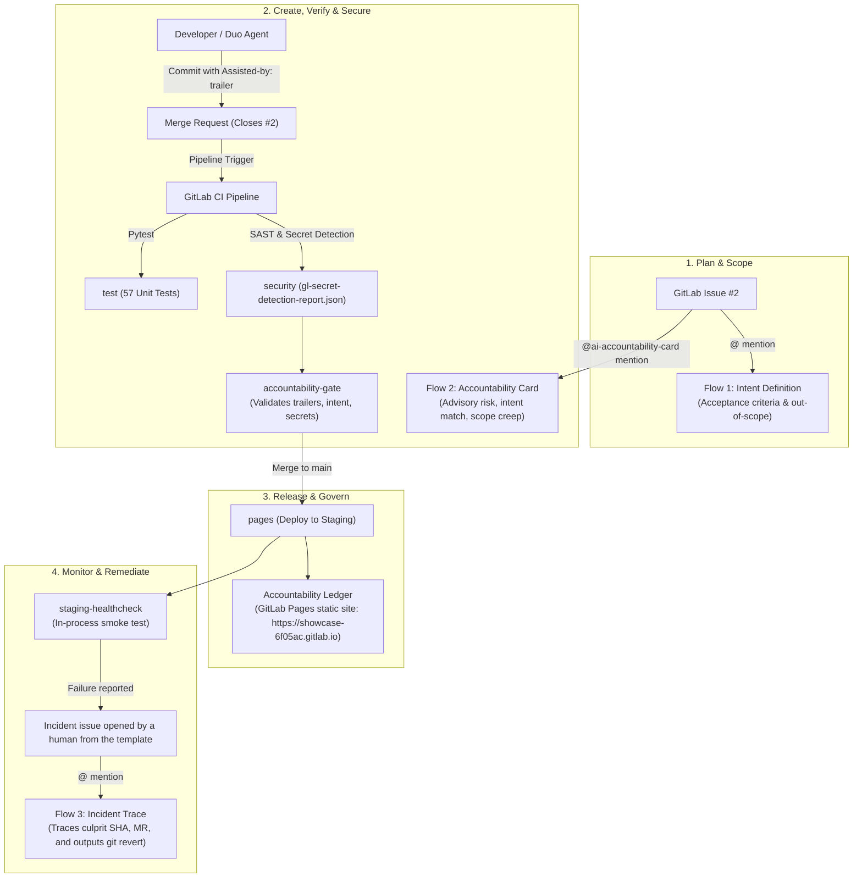

# DuoGate: AI Accountability Pipeline

> **GitLab Transcend Hackathon ("Life After Code") Submission**  
> Automated DevSecOps Lifecycle Governance & Provenance Tracing with the **GitLab Duo Agent Platform**.

---

## 💡 Overview

Generative AI solved code authoring. Engineering teams now ship code faster than ever, but software delivery has encountered a new bottleneck: **governance, traceability, and incident triage**.

When an incident occurs in production, most teams cannot answer:
1. **Where did this code originate?** (Which developer, AI tool, or agent authored it?)
2. **What was it intended to do?** (Which requirement or acceptance criteria justified it?)
3. **Who is responsible?** (Can we trace a failed release back to its commit and MR origin and immediately remediate?)

**`DuoGate`** addresses this challenge through a multi-layered DevSecOps approach:
- **CI Accountability Gate**: A deterministic, non-bypassable pipeline gate that verifies `Assisted-by:` git commit trailers and `Closes #<id>` issue intent linkage, failing non-compliant MRs and pushes.
- **GitLab Pages Accountability Ledger**: A live, statically generated compliance dashboard hosted on GitLab Pages ([https://showcase-6f05ac.gitlab.io](https://showcase-6f05ac.gitlab.io)) that indexes commit history and gate audit reports.
- **GitLab Duo Custom Flows**: Advisory AI workflows that assist humans in evaluating scope, intent match, and post-incident root-cause triage within platform tool constraints.

---

## ⚠️ Honest Limitation & Governance Scope

> [!IMPORTANT]
> **Key Architectural Boundaries & Governance Scope**:
> - **Provenance Contract Applies Going Forward**: AI origin cannot be reliably detected retrospectively in legacy Git commits without metadata. DuoGate establishes an enforceable contract *going forward*: every change must carry an `Assisted-by:` trailer and issue intent link (`Closes #<id>`).
> - **Advisory Flows vs. Enforcing Gate**: Custom flows on the GitLab Duo Agent Platform are advisory only and restricted to confirmed platform tools (`get_issue`, `get_repository_file`, `list_repository_tree`, `create_issue_note`). They do not autonomously block merges. The deterministic CI pipeline gate (`scripts/accountability_gate.py`) is what strictly enforces compliance.
> - **Human-Initiated Incident Remediation**: Incident issues are opened by a human using `.gitlab/issue_templates/incident.md` upon observing staging healthcheck failures.
> - **Demo Commit Provenance**: Provenance trailers on demo branch commits (`Assisted-by: gitlab-duo`) are scripted test fixtures generated by `./scripts/seed_demo.sh`, not commits authored by Duo.

---

## ✅ Verification Status

All verified facts across the project, CI pipeline, and agent interactions:
- **GitLab Project**: [https://gitlab.com/gitlab-ai-hackathon/transcend-october-2026/43738285/showcase](https://gitlab.com/gitlab-ai-hackathon/transcend-october-2026/43738285/showcase)
- **Live Accountability Ledger**: Deployed and accessible at [https://showcase-6f05ac.gitlab.io](https://showcase-6f05ac.gitlab.io).
- **Automated Test Suite**: 57 unit and integration tests passing (`python3 -m pytest -v`) with 100% determinism. GitLab CI test summary reports 57 passed tests.
- **Main Pipeline Green (#2994050055)**: All 5 stages passing on default branch:
  - `test`: Pytest suite executed in clean isolated container with JUnit XML reporting (`artifacts:reports:junit`).
  - `security`: GitLab SAST (`semgrep-sast`) and Secret Detection (`Security/Secret-Detection.gitlab-ci.yml`) passing.
  - `gate`: `accountability-gate` validates commit trailers (`Assisted-by:`), MR intent linkage (`Closes #<id>`), and secret scan reports. Commits at or before `ACCOUNTABILITY_BASELINE_SHA` (`e9672c8`) and merge commits are grandfathered/excluded.
  - `deploy`: `pages` job builds the continuous Accountability Ledger dashboard and publishes to GitLab Pages.
  - `healthcheck`: `staging-healthcheck` runs an in-process smoke test verifying service integrity.
- **Scenario A Executed**:
  - Merge Request !1 (`demo/scenario-a-clean`), description `Closes #2`.
  - MR pipeline #2994044219 passed.
  - Post-merge pipeline #2994050055 on `main` passed.
  - Issue #2 closed automatically by GitLab via `Closes #2`.
- **Accountability Card Flow Verified**: Mentioning `@ai-accountability-card-gitlab-ai-hackathon` on Issue #2 started an advisory Duo session (approx. 2 minutes) that evaluated `demo/scenario-a-clean`, recommended `APPROVE with conditions` at `Risk LOW`, and honestly reported tool boundaries (cannot inspect commit messages or git diff directly).
- **Tracer Bullet Flow Verified**: Mention trigger verified trigger-wiring; output did not match intended design, so it is treated as a trigger smoke test only.
- **Intent and Incident Trace Flows**: Defined in `flows/intent.yml` and `flows/incident-trace.yml`, but NOT executed for this submission.
- **Scenarios B and C**: Provided via `./scripts/seed_demo.sh` but NOT executed on GitLab for this submission; remote branches were pruned from GitLab to ensure no test credentials reside in the public repository.

---

## 🏛️ Architecture & Lifecycle Coverage

`DuoGate` automates 7 of GitLab's 9 lifecycle stages (plan, create, verify, secure, release, monitor, govern) plus incident remediation under **Supervised Autonomy**—agents perform advisory analysis, but the human decides and CI gates enforce.



### DevSecOps Lifecycle Stages Covered

| Lifecycle Stage | Implementation in `DuoGate` | Duo Agent Platform Role |
| :--- | :--- | :--- |
| **Plan** | Flow 1: Intent Definition | Agent drafts acceptance criteria, checklists, and out-of-scope boundaries on issue mention. |
| **Create** | Provenance Trailers & Intent Links | Enforces `Assisted-by: <tool|none>` commit trailers and `Closes #2` MR intent links. |
| **Verify** | Pytest Suite & Flow 2 Card | 57 automated tests + Duo Review Card evaluating intent match and scope creep. |
| **Secure** | GitLab SAST & Secret Detection | Scans merge requests; Gate parses report and halts on exposed credentials. |
| **Release** | GitLab Pages Deployment | Pipeline registers `staging` environment and publishes the build to GitLab Pages (`https://showcase-6f05ac.gitlab.io`). |
| **Govern** | Accountability Gate & Ledger | Automated merge gate + static HTML Accountability Ledger published to Pages (`https://showcase-6f05ac.gitlab.io`). |
| **Monitor** | In-Process Staging Healthcheck | Smoke test verifying `/health` and service endpoints post-deployment. |
| **Remediate** | Flow 3: Incident Trace | Traces failed releases using incident issue fields (culprit SHA, MR, linked issue) and outputs exact `git revert` commands. |

---

## 📂 Repository Structure

```
DuoGate/
├── .gitlab-ci.yml                 # 5-stage pipeline: test -> security -> gate -> deploy -> healthcheck
├── .gitlab/
│   └── issue_templates/
│       └── incident.md            # Telemetry issue template for post-incident triage
├── LICENSE                        # MIT License (Ritesh Garg)
├── README.md                      # Complete architecture & setup documentation
├── DEMO.md                        # Step-by-step walkthrough runbook for demo scenarios
├── DEVPOST.md                     # Official Devpost submission write-up
├── docs/                          # Official GitLab Duo Flow specs & schemas (saved locally)
│   └── README.md                  # Index of official URLs and Flow Registry v1 ambient rules
├── flows/                         # GitLab Duo Custom Flows (v1 Ambient Schema)
│   ├── tracer-bullet.yml          # Minimal flow to verify mention trigger wiring
│   ├── intent.yml                 # Flow 1: Intent, acceptance criteria & out-of-scope list
│   ├── accountability-card.yml    # Flow 2: Origin, diff, scope creep & risk review card
│   └── incident-trace.yml         # Flow 3: Post-incident telemetry trace & git revert output
├── scripts/
│   ├── accountability_gate.py     # CI gate: validates commit trailers, intent, and secrets
│   ├── build_ledger.py            # Generates static HTML Accountability Ledger for Pages
│   ├── smoke_test.py              # In-process staging smoke test runner (with failure mode)
│   └── seed_demo.sh               # Local branch preparation for Demo Scenarios A, B, and C
├── src/
│   ├── app.py                     # Minimal Inventory Microservice (<100 lines Python/Flask)
│   └── requirements.txt           # Minimal dependencies (Flask, pytest, requests)
└── tests/
    ├── conftest.py                # Isolated test environment fixtures (delenv CI variables)
    ├── test_app.py                # 7 unit tests for Flask microservice endpoints
    ├── test_accountability_gate.py# 35 unit & integration tests for gate logic & push mode
    └── test_ledger_and_smoke.py   # 15 tests for ledger generation, XSS escaping, smoke tests
```

---

## 🚀 Setup & Local Execution

### 1. Prerequisites
- Python 3.11+
- Git 2.30+

### 2. Local Installation
```bash
# Clone the repository from GitLab
git clone https://gitlab.com/gitlab-ai-hackathon/transcend-october-2026/43738285/showcase.git
cd showcase

# Configure gitlab remote for demo branches (demo branches are pushed to GitLab only)
git remote add gitlab https://gitlab.com/gitlab-ai-hackathon/transcend-october-2026/43738285/showcase.git

# Install test dependencies
pip install -r src/requirements.txt

# Run the full automated test suite (57 tests)
python3 -m pytest -v
```

### 3. Running Gate & Ledger Locally
```bash
# Test the Accountability Gate in push mode
python3 scripts/accountability_gate.py --mode push

# Generate the Accountability Ledger locally into public/index.html
python3 scripts/build_ledger.py --output-dir public

# Run the in-process healthcheck smoke test
python3 scripts/smoke_test.py

# Simulate an unhealthy release
python3 scripts/smoke_test.py --fail-on-purpose
```

---

## 🦊 GitLab Configuration Guide & Flow Invocation

### 1. Project & Merge Settings
1. Create a **Public** project on GitLab named `DuoGate`.
2. Navigate to **Settings > Merge requests**:
   - Set **Merge method** to **Merge commit** (preserves individual commit history and `Assisted-by:` trailers in `main`).
3. Navigate to **Deploy > Pages**:
   - Ensure Pages access is set to **Everyone** so the public Accountability Ledger is accessible at `https://showcase-6f05ac.gitlab.io`.

### 2. How to Register and Invoke Flows
In GitLab:
1. Navigate to **AI > Flows** (or **Automate > Flows**).
2. Click **New flow**, paste the YAML flow definition from `flows/`, and enable the **Mention** trigger. Note the generated service account (e.g. `@ai-accountability-card-gitlab-ai-hackathon`).
3. To invoke a flow, mention its service account in an issue comment, specifying the branch name and issue number:
   ```text
   @ai-accountability-card-gitlab-ai-hackathon review branch demo/scenario-a-clean for issue #2
   ```
   *(Note: Custom flows currently operate using `get_issue`, `get_repository_file`, `list_repository_tree`, and `create_issue_note`; passing the branch and issue in the comment provides the necessary context).*

---

## Demo Scenarios

Demo branches are pushed to GitLab only. Run the seeding script to prepare the demo branches locally:
```bash
./scripts/seed_demo.sh
```

### Scenario A: Clean Feature MR (Executed & Verified)
1. Push branch: `git push -u gitlab demo/scenario-a-clean`.
2. Open MR !1 with description: `Implements aggregated inventory summary calculation. Closes #2`.
3. Mention `@ai-accountability-card-gitlab-ai-hackathon` on Issue #2 with `review branch demo/scenario-a-clean for issue #2`.
4. **Observed Result**:
   - MR pipeline #2994044219 passed (`test`, `semgrep-sast`, `secret_detection`, `accountability-gate`).
   - Duo session posted review card to Issue #2: Recommendation `APPROVE with conditions`, Risk `LOW`, noted endpoint additions, and honestly flagged lack of commit trailer inspection tools.
   - Merged MR !1 into `main`. Pipeline #2994050055 on `main` passed (57 tests passing).
   - Issue #2 closed automatically by GitLab via `Closes #2`.
   - Continuous Accountability Ledger updated live on GitLab Pages at [https://showcase-6f05ac.gitlab.io](https://showcase-6f05ac.gitlab.io).

### Scenario B: Unvetted AI Code (Missing Trailer, Scope Creep & Secret Detection)
> [!NOTE]
> **Provided but not executed for this submission; run `./scripts/seed_demo.sh` to generate the branches locally.**  
> The remote branch `demo/scenario-b-bad-gate` was pruned from the GitLab remote prior to final submission. No outcome claims are made beyond the local automated test harness.

1. Generate branch locally: `./scripts/seed_demo.sh`.
2. Inspect branch: contains missing trailer, unrelated file (`src/unrelated_admin_tool.py`), and fake dummy AWS key (`AKIAZ7QX3PLM9RTK2VNB`, commented FAKE strictly for Secret Detection testing).
3. If pushed and opened as MR, `accountability-gate` and Secret Detection verify gate enforcement.

### Scenario C: Post-Deploy Incident & Root Cause Trace
> [!NOTE]
> **Provided but not executed for this submission; run `./scripts/seed_demo.sh` to generate the branches locally.**  
> The remote branch `demo/scenario-c-bad-healthcheck` was pruned from the GitLab remote prior to final submission. No outcome claims are made beyond the local automated test harness.

1. Generate branch locally: `./scripts/seed_demo.sh`.
2. Inspect branch: modifies `/health` to return HTTP 500 (`Unhandled DBConnectionPoolTimeout`), causing staging healthcheck failure.
3. Incident issue can be opened by a human using `.gitlab/issue_templates/incident.md`.
4. Mentioning Flow 3 traces culprit commit and outputs rollback command `git revert <culprit_sha> --no-edit`.

---

## 📄 License

This project is licensed under the [MIT License](LICENSE) &copy; 2026 Ritesh Garg.
