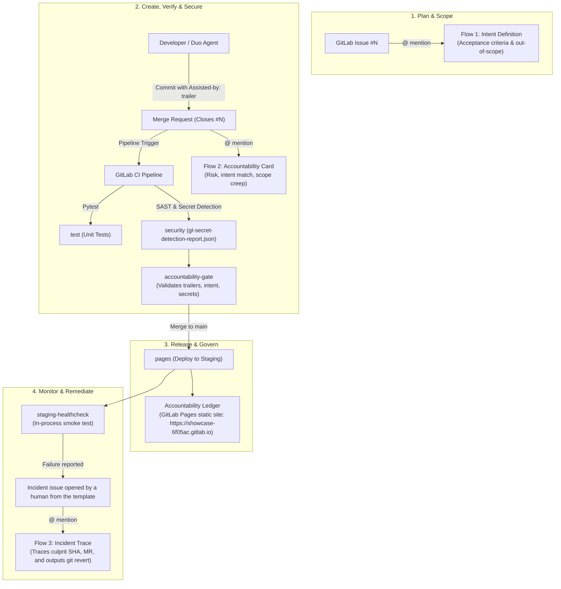

# DuoGate: AI Accountability Pipeline

> **GitLab Transcend Hackathon ("Life After Code") Submission**  
> Automated DevSecOps Lifecycle Governance & Provenance Tracing with the **GitLab Duo Agent Platform**.

---

## 💡 Overview

Generative AI solved code authoring. Engineering teams now ship code faster than ever, but software delivery has encountered a new bottleneck: **governance, traceability, and incident triage**.

When an incident occurs in production, most teams cannot answer:
1. **Where did this code originate?** (Which developer, AI tool, or agent authored it?)
2. **What was it intended to do?** (Which requirement or acceptance criteria justified it?)
3. **Who is responsible?** (Can we trace a failed release back to its commit and MR origin and immediately remediate?)

**`DuoGate`** closes this gap. It is an end-to-end DevSecOps pipeline and GitLab Duo custom flow suite that makes every change carry metadata provenance (`Assisted-by:` trailers) and explicit intent linkage (`Closes #<id>`), gates merges automatically via CI, maintains a live **Accountability Ledger** on GitLab Pages, and equips Duo agents to triage intent, evaluate review risk, and trace release incidents back to their source.

---

## ⚠️ Honest Limitation & Governance Scope

> [!IMPORTANT]
> **Provenance Contract Applies Going Forward**: AI origin cannot be reliably detected retrospectively in legacy Git commits without metadata. Rather than guessing with unreliable statistical heuristics, `DuoGate` establishes an **enforceable governance contract going forward**:
> - Every commit must declare its provenance trailer (`Assisted-by: <tool|agent|none>`).
> - Every MR must link to an intent issue (`Closes #<id>` or `Fixes #<id>`).
> - Merge gates block non-compliant commits from reaching the default branch.

---

## ✅ Verification Status

All components of DuoGate have been systematically verified against GitLab CI and local test harnesses:
- **Automated Test Suite**: 56 unit and integration tests passing (`python3 -m pytest -v`) with 100% determinism.
- **GitLab CI Pipeline**: Full 5-stage pipeline verified green on default branch:
  - `test`: Unit tests executed under clean, isolated environments with JUnit XML test reporting (`artifacts:reports:junit`).
  - `security`: SAST (`semgrep-sast`) and Secret Detection (`Security/Secret-Detection.gitlab-ci.yml`) passing.
  - `gate`: `accountability-gate` validates commit trailers (`Assisted-by:`), MR intent linkage (`Closes #<id>`), and secret scan reports.
  - `deploy`: `pages` job builds the continuous Accountability Ledger dashboard and publishes to GitLab Pages.
  - `healthcheck`: `staging-healthcheck` runs an in-process smoke test verifying service integrity.
- **Accountability Gate & Baseline Grandfathering**:
  - Merge Request mode: Inspects `base..head` commits and requires explicit issue intent.
  - Push mode: Inspects `CI_COMMIT_BEFORE_SHA..CI_COMMIT_SHA` (or `HEAD` if root/force push), skipping intent checks (checked at MR time).
  - Grandfathering: Commits at or before `ACCOUNTABILITY_BASELINE_SHA` (`e9672c8`, GitLab starter commit) and merge commits are classified and exempted from provenance requirements without rewriting Git history.
- **Ledger Configuration (`LEDGER_DIR`)**: `src/app.py` exposes `/ledger` backed by `LEDGER_DIR` (defaults to `public/`), verified with standalone tests.
- **Live Accountability Ledger**: Deployed and accessible at [https://showcase-6f05ac.gitlab.io](https://showcase-6f05ac.gitlab.io).

---

## 🏛️ Architecture & Lifecycle Coverage

`DuoGate` automates 7 of GitLab's 9 lifecycle stages (plan, create, verify, secure, release, monitor, govern) plus incident remediation under **Supervised Autonomy**—agents perform multi-step analysis, but the human retains final authority (*"Advisory only: a human decides"*).



### DevSecOps Lifecycle Stages Covered

| Lifecycle Stage | Implementation in `DuoGate` | Duo Agent Platform Role |
| :--- | :--- | :--- |
| **Plan** | Flow 1: Intent Definition | Agent generates acceptance criteria, checklists, and out-of-scope boundaries on mention. |
| **Create** | Provenance Trailers & Intent Links | Enforces `Assisted-by: <tool|none>` commit trailers and `Closes #N` MR intent links. |
| **Verify** | Pytest Suite & Flow 2 Card | Unit tests + Duo Review Card evaluating intent match and scope creep. |
| **Secure** | GitLab SAST & Secret Detection | Scans merge requests; Gate parses report and halts on exposed credentials. |
| **Release** | GitLab Pages Deployment | Pipeline registers `staging` environment and publishes the build to GitLab Pages (`https://showcase-6f05ac.gitlab.io`). |
| **Govern** | Accountability Gate & Ledger | Automated merge gate + static HTML Accountability Ledger published to Pages (`https://showcase-6f05ac.gitlab.io`). |
| **Monitor** | In-Process Staging Healthcheck | Smoke test verifying `/health` and service endpoints post-deployment. |
| **Remediate** | Flow 3: Incident Trace | Traces failed releases using incident issue fields (culprit SHA, MR, linked issue) and outputs exact `git revert` commands. |

---

## 📂 Repository Structure

```
DuoGate/
├── .gitlab-ci.yml                 # 5-stage pipeline: test -> security -> gate -> deploy -> healthcheck
├── .gitlab/
│   └── issue_templates/
│       └── incident.md            # Telemetry issue template for post-incident triage
├── LICENSE                        # MIT License (Ritesh Garg)
├── README.md                      # Complete architecture & setup documentation
├── DEMO.md                        # Step-by-step walkthrough runbook for demo scenarios
├── DEVPOST.md                     # Official Devpost submission write-up
├── docs/                          # Official GitLab Duo Flow specs & schemas (saved locally)
│   └── README.md                  # Index of official URLs and Flow Registry v1 ambient rules
├── flows/                         # GitLab Duo Custom Flows (v1 Ambient Schema)
│   ├── tracer-bullet.yml          # Minimal 15-line flow to verify trigger & issue note
│   ├── intent.yml                 # Flow 1: Intent, acceptance criteria & out-of-scope list
│   ├── accountability-card.yml    # Flow 2: Origin, diff, scope creep & risk review card
│   └── incident-trace.yml         # Flow 3: Post-incident telemetry trace & git revert output
├── scripts/
│   ├── accountability_gate.py     # CI gate: validates commit trailers, intent, and secrets
│   ├── build_ledger.py            # Generates static HTML Accountability Ledger for Pages
│   ├── smoke_test.py              # In-process staging smoke test runner (with failure mode)
│   └── seed_demo.sh               # Local branch preparation for Demo Scenarios A, B, and C
├── src/
│   ├── app.py                     # Minimal Inventory Microservice (<100 lines Python/Flask)
│   └── requirements.txt           # Minimal dependencies (Flask, pytest, requests)
└── tests/
    ├── conftest.py                # Isolated test environment fixtures
    ├── test_app.py                # Unit tests for Flask microservice endpoints
    ├── test_accountability_gate.py# 35 unit & integration tests for gate logic & push mode
    └── test_ledger_and_smoke.py   # 15 tests for ledger generation, XSS escaping, smoke tests
```

---

## 🚀 Setup & Local Execution

### 1. Prerequisites
- Python 3.11+
- Git 2.30+

### 2. Local Installation
```bash
# Clone the repository from GitLab
git clone https://gitlab.com/gitlab-ai-hackathon/transcend-october-2026/43738285/showcase.git
cd showcase

# Configure gitlab remote for demo branches (demo branches are pushed to GitLab only)
git remote add gitlab https://gitlab.com/gitlab-ai-hackathon/transcend-october-2026/43738285/showcase.git

# Install test dependencies
pip install -r src/requirements.txt

# Run the full automated test suite (56 tests)
python3 -m pytest -v
```

### 3. Running Gate & Ledger Locally
```bash
# Test the Accountability Gate in push mode
python3 scripts/accountability_gate.py --mode push

# Generate the Accountability Ledger locally into public/index.html
python3 scripts/build_ledger.py --output-dir public

# Run the in-process healthcheck smoke test
python3 scripts/smoke_test.py

# Simulate an unhealthy release
python3 scripts/smoke_test.py --fail-on-purpose
```

---

## 🦊 GitLab Configuration Guide

### 1. Project & Merge Settings
1. Create a **Public** project on GitLab named `DuoGate`.
2. Navigate to **Settings > Merge requests**:
   - Set **Merge method** to **Merge commit** (preserves individual commit history and `Assisted-by:` trailers in `main`).
3. Navigate to **Deploy > Pages**:
   - Ensure Pages access is set to **Everyone** so the public Accountability Ledger is accessible at `https://showcase-6f05ac.gitlab.io`.

### 2. Register GitLab Duo Custom Flows
In GitLab, open the project's Flows page (under the AI or Automate menu, depending on GitLab version), then New flow:
1. **Tracer Bullet** (`flows/tracer-bullet.yml`): Register and add **Mention** trigger. Note configured mention handle (e.g. `@<tracer-bullet-handle>`).
2. **Intent Flow** (`flows/intent.yml`): Register and add **Mention** trigger. Note configured mention handle (`@<intent-flow-handle>`).
3. **Accountability Card** (`flows/accountability-card.yml`): Register and add **Mention** trigger. Note configured mention handle (`@<card-flow-handle>`).
4. **Incident Trace** (`flows/incident-trace.yml`): Register and add **Mention** trigger. Note configured mention handle (`@<incident-flow-handle>`).

---

## Running Demo Scenarios

Demo branches are pushed to GitLab only. Run the seeding script to prepare the three demo branches locally:
```bash
./scripts/seed_demo.sh
```

### Scenario A: Clean Feature MR (Passes & Deploys)
1. Push branch: `git push -u gitlab demo/scenario-a-clean`.
2. Open MR with description: `Implements inventory summary endpoint. Closes #2`.
3. Mention `@<card-flow-handle>` in the MR comment.
4. **Expected result (to be confirmed after the first run)**: All tests pass, Accountability Gate passes, Review Card recommends `APPROVE`. Merging deploys to staging and appends a verified entry to the Pages Accountability Ledger (`https://showcase-6f05ac.gitlab.io`).

### Scenario B: Unvetted AI Code (Gate & Secret Catch)
1. Push branch: `git push -u gitlab demo/scenario-b-bad-gate`.
2. Open MR with description: `Adds admin tool without linked issue.`
3. **Expected result (to be confirmed after the first run)**:
   - `accountability-gate` fails the pipeline due to a missing `Assisted-by:` trailer.
   - GitLab Secret Detection flags the fake AWS key (`AKIAZ7QX3PLM9RTK2VNB`, commented as FAKE and existing only on this branch).
   - Accountability Card highlights scope creep (`unrelated_admin_tool.py`), rates risk as **HIGH**, and recommends **REJECT**.

### Scenario C: Post-Deploy Incident & Root Cause Trace
1. Push branch: `git push -u gitlab demo/scenario-c-bad-healthcheck` and merge to `main`.
2. Staging deploy runs, but `staging-healthcheck` fails on `GET /health` (`HTTP 500`).
3. Incident issue opened by a human from the template (`.gitlab/issue_templates/incident.md`).
4. Mention `@<incident-flow-handle>`: Flow 3 traces using the incident issue's fields (culprit SHA, MR, linked issue) and available tools, and outputs:
   ```bash
   git revert <culprit_sha> --no-edit && git push gitlab main
   ```
5. **Expected result (to be confirmed after the first run)**: Executing the revert command restores staging health immediately on the subsequent pipeline run.

---

## 📄 License

This project is licensed under the [MIT License](LICENSE) &copy; 2026 Ritesh Garg.
